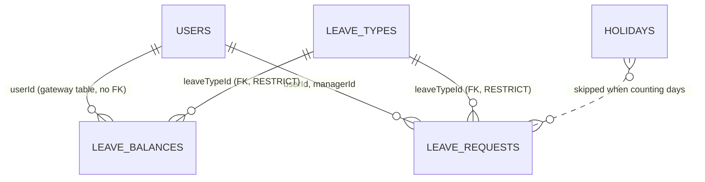

# Architecture

Fill in **Domain notes** and **Demo script** for your project before the PR.

## Request flow

```text
Browser → web :3000
            /api/*  (Next rewrite)
              ↓
         gateway :3001   cookie JWT, /auth/*
              ↓
         api :3002       your domain modules
              ↓
         Postgres :5434
```

## Who owns what

| Layer          | Owns                        | Does not own       |
| -------------- | --------------------------- | ------------------ |
| Next UI        | Pages, layout, forms        | Product CRUD APIs  |
| TanStack Query | Server lists and mutations  | Form drafts        |
| Redux Toolkit  | Drafts, filters, selection  | Nest entity arrays |
| API gateway    | Login cookies, CORS, proxy  | Domain tables      |
| Domain API     | Entities, rules, migrations | Browser cookies    |
| Postgres       | Data + constraints          | —                  |

## Folders

| Path               | Role                                                                                  |
| ------------------ | ------------------------------------------------------------------------------------- |
| `apps/web`         | Next UI (`:3000`) — `@app/web`                                                        |
| `apps/api-gateway` | Auth + BFF (`:3001`) — `@app/api-gateway`                                             |
| `apps/api`         | Domain Nest API (`:3002`) — `@app/api` (**your Must work**)                           |
| `libs/ui`          | Shared UI kit + theme — prefer `@shared/ui/components` ([frontend.md](./frontend.md)) |
| `libs/*`           | Other shared packages (`@shared/*`) — folder subpaths when folders exist              |
| `docker/`          | Compose: Postgres only · deploy stubs: `Dockerfile.{gateway,api,web}`                 |
| `docs/projects/`   | Capstone briefs                                                                       |

Optional Stretch microservice: [adding-a-service.md](./adding-a-service.md).

## Conventions

- Responses: `{ data: T }` — `@shared/http` envelope (`@shared/http/filters`, `@shared/http/interceptors`) + `@shared/api-client`
- Errors: `{ statusCode, error, message, details? }` via shared `AllExceptionsFilter`
- Browser auth: httpOnly cookie from the gateway (`@Public()` for anonymous routes)
- Domain API auth: Bearer JWT (gateway forwards the cookie as `Authorization`)
- Shared auth: `@shared/http/auth` (`JwtAuthGuard`, `RolesGuard`, `@Public` / `@Roles`) — apps re-export via `common/auth`
- Cookie→Bearer hop: `apps/api-gateway/src/common/proxy-hop.ts` (unit-tested)
- OpenAPI: `/docs` on gateway (cookie) and domain API (Bearer) via `@shared/http/swagger` — local/dev only
- UI: `@shared/ui/components` + `@shared/ui/theme.css` — [frontend.md](./frontend.md); gallery at `/ui`
- Imports: prefer folder subpaths (`@shared/pkg/folder`); Nest apps use folder `index.ts` barrels (`./config`, `./common/auth`, `./modules/auth`); flat packages stay on the package root until a folder exists
- Entities: `*.entity.ts` under `apps/api/src/modules/`
- Users migration/seed: gateway · domain migrations: `apps/api`
- Smoke: `pnpm doctor` (per-hop) or `http://localhost:3000/api/ready`
- Scripts: see root [README](../README.md) (`pnpm dev`, `pnpm doctor`, `pnpm dev:api`, …)

## Domain notes — Leave Management

Employees apply for leave, the API counts the working days, and the request is approved one level up.
Approving takes the days off the employee's balance in the same transaction.

### Roles

| Gateway role | Domain role | Can                                                                                                    | Home                 |
| ------------ | ----------- | ------------------------------------------------------------------------------------------------------ | -------------------- |
| `user`       | Employee    | Apply, see own balances and requests, cancel own pending, remove own cancelled                         | `/leave`             |
| `staff`      | Manager     | Approve / reject **employee** requests, see all requests with filters, who's away, apply for own leave | `/manager/requests`  |
| `admin`      | Admin       | Leave types, balances, holidays, all requests (incl. deleted), approve / reject **manager** requests   | `/admin/leave-types` |

Approval chain: employee leave is decided by a manager, a manager's leave by an admin, nobody decides their own
(403). The rule lives in `apps/api/src/modules/leave-requests/leave-rules.ts` and is mirrored in
`apps/web/lib/leave/decisions.ts` so the UI only shows buttons the user may press.

### Data model



| Table            | Key columns                                                                                                                          | Constraints                                                                                                                                                             |
| ---------------- | ------------------------------------------------------------------------------------------------------------------------------------ | ----------------------------------------------------------------------------------------------------------------------------------------------------------------------- |
| `leave_types`    | `name`, `defaultDays`, `deletedAt` (archive)                                                                                         | `CHK_leave_types_default_days`, unique `lower(name)` among active types                                                                                                 |
| `leave_balances` | `userId`, `leaveTypeId`, `year`, `totalDays`, `usedDays`                                                                             | `UQ_leave_balances_user_type_year`, `CHK_leave_balances_used_lte_total`, `CHK_leave_balances_non_negative`                                                              |
| `leave_requests` | `userId`, `leaveTypeId`, `startDate`, `endDate`, `days`, `reason`, `status`, `managerId`, `managerComment`, `decidedAt`, `deletedAt` | `CHK_leave_requests_dates` (end ≥ start), `CHK_leave_requests_days` (> 0), `CHK_leave_requests_same_year`, `CHK_leave_requests_status`, `EXC_leave_requests_no_overlap` |
| `holidays`       | `date`, `name`                                                                                                                       | `UQ_holidays_date`                                                                                                                                                      |

Migrations are hand-written SQL in `apps/api/src/database/migrations/` (ledger table `migrations_api`). The
entities declare the same constraint names, so `migration:generate --check` reports no drift.

### Hard invariant

An employee can't hold two pending/approved requests with overlapping dates, and can't ask for more days than they
have left (`totalDays − usedDays − pending days`, per leave type and year).

| Rule                          | Service (`leave-requests.service.ts`)                   | Database                                                       |
| ----------------------------- | ------------------------------------------------------- | -------------------------------------------------------------- |
| No overlap (pending/approved) | `findOverlap` → **409** naming the clashing dates       | `EXC_leave_requests_no_overlap` (btree_gist, `daterange '[]'`) |
| Enough days left              | balance row locked `FOR UPDATE`, then checked → **400** | `CHK_leave_balances_used_lte_total`                            |
| At least one working day      | `countWorkingDays` (Mon–Fri minus holidays) → **400**   | `CHK_leave_requests_days`                                      |
| Same year, end ≥ start        | `assertDateRange` → **400**                             | `CHK_leave_requests_same_year`, `CHK_leave_requests_dates`     |
| Only pending can move         | `assertPending` → **400**                               | `CHK_leave_requests_status`                                    |

The exclusion constraint is what makes the overlap rule race-proof: two simultaneous submits can both pass the
service check, only the database sees both writes. Its error (`23P01`) is turned into a 409.

An admin editing a balance can't break the second rule either. `PUT /balances` locks the same balance row and
refuses (**400**) a total below `usedDays + pending days`, otherwise a request that was valid when sent would no
longer fit and its approval would fail.

### Required transaction: approve

`POST /leave-requests/:id/approve` runs in one `dataSource.transaction`:

1. lock the request (`pessimistic_write`, no joins) → 404 missing · 403 own or wrong level · 400 not pending
2. recount the working days, in case a holiday was added since applying → 400 if none are left, `days` updated if
   it changed
3. lock the balance row → 400 if `usedDays + days > totalDays`
4. `usedDays += days`, and the request gets `status = approved`, `managerId`, `managerComment`, `decidedAt`

If any step fails nothing is saved. Lock order is always request → balance, so two transactions can't deadlock.
When two managers approve the same request at once, one gets 200 and the other waits, then sees `approved` and gets 400.

### List endpoint, pagination, soft delete

- `GET /leave-requests` (staff, admin) and `GET /leave-requests/me` (user, staff): `page` (default 1), `limit`
  (default 20, max 100), filters `status`, `leaveTypeId`, `from`, `to` (requests overlapping the range), `userId`.
  Response `{ data: { items, total, page, limit } }`. Invalid paging → 400, empty filter strings are ignored.
- Soft delete on `LeaveRequest` (`@DeleteDateColumn`): `DELETE /leave-requests/:id`. The owner can remove their own
  **cancelled** request, an admin can remove any **cancelled or rejected** one. These never touched a balance.
  Default lists hide deleted rows, admins can pass `includeDeleted=true` ("Show deleted" on `/admin/requests`).
- Deleting a leave type archives it (a plain `deletedAt` column rather than `@DeleteDateColumn`, so old requests
  still join their type). It is refused with 409 while the type has pending requests.

### Documented exceptions

`docs/projects/README.md` (line 234) asks for exceptions to the shared standards to be documented here.

1. **400 instead of 409 for balance errors.** The shared standard says invariant conflicts are always 409
   ("duplicate apply, oversell"). This project's brief asks for **400** for "not enough days left", "no balance set"
   and "approve a request that isn't pending", including in its demo cases. We follow the brief: those three
   return 400. Overlapping dates return 409, which both documents agree on.
2. **Managers apply for leave too.** The brief's route table gives `/leave/*` and the self-service endpoints
   (`GET /balances/me`, `POST /leave-requests`, `GET /leave-requests/me`, `POST /:id/cancel`) to `user` only. We
   also allow `staff`. The brief says a manager "cannot approve their own request" (403), which can only happen if
   managers have requests.
3. **Admins decide managers' leave.** The brief gives approve/reject to `staff`. We allow `staff` and `admin`, and
   the service enforces one level up: employee leave → manager, manager leave → admin, own request → 403. Without
   it, a team with one manager could never get that manager's leave approved.

### Other decisions

- **Employee directory:** `apps/api/src/modules/employees` reads `id, name, email, role` from the gateway's `users`
  table with read-only SQL (both apps share one database). There is no `User` entity, no foreign key and no copied
  user column. If the services ever get separate databases, only that module changes.
- **Dates** are Postgres `date` columns sent as `YYYY-MM-DD`, and all date math is UTC on strings. `days` is
  captured when the request is made and **recounted when a pending request is approved**, so a holiday added in
  between is never charged. Approved, rejected and cancelled requests keep their stored `days`.
- **Who can remove a request:** cancelling was the employee's own action, so they may remove a cancelled request
  from their history. A rejection is the manager's decision and stays on record: removing it as the employee gets
  403, only an admin can remove it.
- **Whole days only** (half days are Stretch).
- The gateway seed gained two employees (`asha@`, `rohan@demo.local`) because the brief needs balances for three.

### Running it

```bash
pnpm docker:db
pnpm migration:run && pnpm seed          # gateway: admin, staff, user, asha, rohan (password123)
pnpm migration:run:api && pnpm seed:api  # domain: 3 leave types, 9 holidays, 24 balances, 11 requests
pnpm dev                                 # http://localhost:3000
```

The domain seed resets the leave tables and uses dates relative to the current week, so running it again gives a
fresh demo with upcoming leave. Unit tests (`pnpm test`) cover working days, date helpers, the leave rules including
the approval chain, the approve/reject transaction, database error mapping, web routing, Redux slices and formatting.

## Demo script (≤ 5 minutes)

Before recording: `pnpm seed && pnpm seed:api`, then `pnpm dev`. Seed dates follow the current week, so the steps
use relative dates.

1. **Roles (30 s)**
   - `admin@demo.local` → Leave types (Casual, Earned, Sick) → Balances: pick Asha Verma, set Casual to 15, Save.
   - `staff@demo.local` → Approvals: pending requests, their own row says "Your request" (no buttons).
   - `user@demo.local` → dashboard: "Casual 7 of 12 days left". Typing `/manager/requests` → **Access denied**.
2. **Happy path (2 min)**
   - Employee: **Apply** → Casual, this week's Friday → next Tuesday. The form shows "3 working days, Fri to Tue".
     Send → the request is **Pending** and the Casual card shows 4 left.
   - Manager: Approvals → **Approve** with a comment.
   - Employee: the request is **Approved** with the manager's comment, and the days now count as used.
3. **Invariant (30 s)**, as the employee:
   - apply again for the Tuesday → **409** "These dates overlap your approved request from … to …"
   - apply Casual for two full working weeks → **400** "Not enough Casual days: this request needs 10, you have … left"
4. **Lists (1 min)**
   - Manager: Status = Approved plus a From/To range → the table, the active-filter chips and the pagination update.
   - Admin: Requests → Status = Cancelled → **Delete** → the row disappears. Tick **Show deleted** → it is back with a
     "Deleted" badge.
5. **Bonus (30 s):** approve a request that is already approved (second tab) → **400** "Only pending requests can be
   approved, this one is already approved". Admin approves the manager's own pending request (one level up).

| Demo 4xx                             | Status | Message                                                               |
| ------------------------------------ | ------ | --------------------------------------------------------------------- |
| Overlapping dates                    | 409    | "These dates overlap your … request from … to …"                      |
| More days than the balance           | 400    | "Not enough Casual days: this request needs …, you have … left"       |
| Approve a request that isn't pending | 400    | "Only pending requests can be approved, this one is already approved" |
