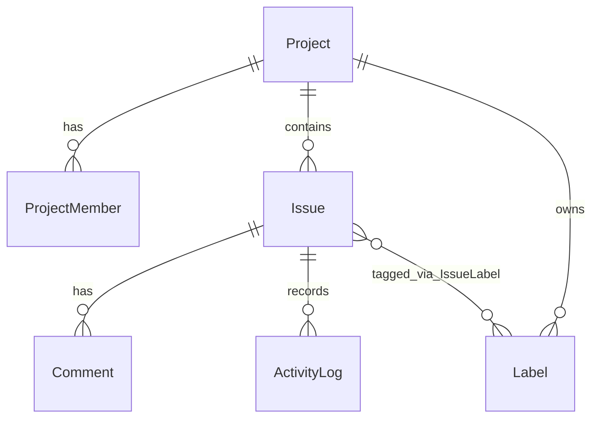

# Architecture

## Request flow

```text
Browser → web :3000
            /api/*  (Next rewrite)
              ↓
         gateway :3001   cookie JWT, /auth/*
              ↓
         api :3002       TaskFlow domain modules + Socket.io `/issues`
              ↓
         Postgres :5434
```

## Who owns what

| Layer          | Owns                        | Does not own       |
| -------------- | --------------------------- | ------------------ |
| Next UI        | Pages, layout, forms        | Product CRUD APIs  |
| TanStack Query | Server lists and mutations  | Form drafts        |
| Redux Toolkit  | Drafts, filters, selection  | Nest entity arrays |
| API gateway    | Login cookies, CORS, proxy  | Domain tables      |
| Domain API     | Entities, rules, migrations | Browser cookies    |
| Postgres       | Data + constraints          | —                  |

## Folders

| Path               | Role                                                                                  |
| ------------------ | ------------------------------------------------------------------------------------- |
| `apps/web`         | Next UI (`:3000`) — `@app/web`                                                        |
| `apps/api-gateway` | Auth + BFF (`:3001`) — `@app/api-gateway`                                             |
| `apps/api`         | Domain Nest API (`:3002`) — `@app/api` (**your Must work**)                           |
| `libs/ui`          | Shared UI kit + theme — prefer `@shared/ui/components` ([frontend.md](./frontend.md)) |
| `libs/*`           | Other shared packages (`@shared/*`) — folder subpaths when folders exist              |
| `docker/`          | Compose: Postgres only · deploy stubs: `Dockerfile.{gateway,api,web}`                 |
| `docs/projects/`   | Capstone briefs                                                                       |

## Conventions

- Responses: `{ data: T }` — `@shared/http` envelope
- Errors: `{ statusCode, error, message, details? }`
- Browser auth: httpOnly cookie from the gateway
- Domain API auth: Bearer JWT (gateway forwards the cookie as `Authorization`)
- Soft-delete: `DELETE /issues/:id` sets `deletedAt`
- Live updates: Socket.io namespace `/issues` emits `issue.updated` (Stretch)

## Domain notes

**Slug:** `project-management` (TaskFlow)

**Roles**

| Gateway | Domain                                         |
| ------- | ---------------------------------------------- |
| `staff` | Project lead — create projects, manage members |
| `user`  | Member — issues/comments in joined projects    |
| `admin` | Can list all projects; lead-like ops           |

**ERD**



**Hard invariants**

1. Only project members may mutate issues → **403**
2. Status machine: `todo → in_progress → done` (and `done → in_progress`, `in_progress → todo`) → **400** on illegal jumps
3. Create issue runs in a transaction: issue + labels + activity log

**Key modules:** `projects`, `issues`, `labels`, `realtime`

**Seed:** `pnpm seed` (users) then `pnpm seed:api` (domain). Demo passwords: `password123`.

## Demo script

1. **Roles (30s):** Log in as `staff@demo.local` → Projects → open TaskFlow Core. Log out → `user@demo.local` → same project board (no Create project).
2. **Happy path (2m):** Lead creates issue → member comments → move Todo → In progress → Done → activity timeline shows status changes.
3. **Invariant (30s):** As user, open another browser without membership (or call API as outsider) → mutate issue → **403**. Or jump Todo → Done on board → **400**.
4. **Lists (1m):** Filter issues by label/status; soft-delete an issue → gone from board/list; old URL shows not found.
5. **Live (30s):** Two tabs on the board; change status in one → other refreshes via `issue.updated` WebSocket.

## Deploy (Vercel + Railway)

### Topology

```text
Browser
  → Vercel (apps/web)  — /api/* rewritten to public gateway
  → Railway api-gateway (cookie JWT)  — public HTTPS
  → Railway api (domain + Socket.io /issues)  — public HTTPS for WS; private DNS for gateway hop
  → Railway Postgres
```

### Environment matrix

| Service       | Variable                      | Example / notes                                           |
| ------------- | ----------------------------- | --------------------------------------------------------- |
| Gateway + API | `DATABASE_URL`                | Railway Postgres connection string (same DB)              |
| Gateway + API | `JWT_SECRET`                  | Long shared secret (≥16 chars)                            |
| Gateway       | `COOKIE_SECURE`               | `true`                                                    |
| Gateway       | `CORS_ORIGIN`                 | `https://<vercel-app>.vercel.app`                         |
| Gateway       | `API_UPSTREAM_URL`            | `http://<api-service>.railway.internal:3002`              |
| API           | `CORS_ORIGIN`                 | Same Vercel origin (Socket.io CORS)                       |
| API           | `PORT`                        | `3002`                                                    |
| Web (Vercel)  | `API_GATEWAY_URL`             | `https://<gateway>.up.railway.app`                        |
| Web (Vercel)  | `NEXT_PUBLIC_API_URL`         | `/api`                                                    |
| Web (Vercel)  | `NEXT_PUBLIC_WS_URL`          | `https://<api>.up.railway.app`                            |
| Web (Vercel)  | `NEXT_PUBLIC_CSP_CONNECT_SRC` | `https://<api>.up.railway.app wss://<api>.up.railway.app` |

### Release steps

1. Create a Railway project; add **Postgres**, **api**, **api-gateway**.
2. Build **api** with `docker/Dockerfile.api`; **gateway** with `docker/Dockerfile.gateway`.
3. Set env vars from the table above (wire `DATABASE_URL` from the Postgres plugin).
4. On first deploy (or as a release command), from the monorepo:

```bash
pnpm migration:run      # gateway users table
pnpm seed               # demo users (optional in prod)
pnpm migration:run:api  # TaskFlow domain tables
pnpm seed:api           # demo projects/issues (optional)
```

5. Create a Vercel project pointing at this repo; set Root / filter so `apps/web` builds (`pnpm --filter @app/web build`). Set the web env vars; redeploy after gateway/api URLs exist.
6. Smoke checklist: login → projects → board status change → second tab updates via WebSocket.

### Local Docker image smoke (optional)

```bash
docker build -f docker/Dockerfile.api -t taskflow-api .
docker build -f docker/Dockerfile.gateway -t taskflow-gateway .
docker build -f docker/Dockerfile.web -t taskflow-web .
```

### Live URLs

Fill in after deploy:

- Web: `https://…`
- Gateway: `https://…`
- API (WS): `https://…`
