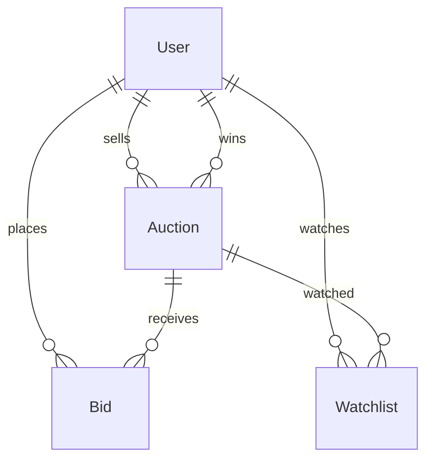

# Architecture

Fill in **Domain notes** and **Demo script** for your project before the PR.

## Request flow

```text
Browser → web :3000
            /api/*  (Next rewrite)
              ↓
         gateway :3001   cookie JWT, /auth/*
              ↓
         api :3002       your domain modules
              ↓
         Postgres :5434
```

## Who owns what

| Layer          | Owns                        | Does not own       |
| -------------- | --------------------------- | ------------------ |
| Next UI        | Pages, layout, forms        | Product CRUD APIs  |
| TanStack Query | Server lists and mutations  | Form drafts        |
| Redux Toolkit  | Drafts, filters, selection  | Nest entity arrays |
| API gateway    | Login cookies, CORS, proxy  | Domain tables      |
| Domain API     | Entities, rules, migrations | Browser cookies    |
| Postgres       | Data + constraints          | —                  |

## Folders

| Path               | Role                                                                                  |
| ------------------ | ------------------------------------------------------------------------------------- |
| `apps/web`         | Next UI (`:3000`) — `@app/web`                                                        |
| `apps/api-gateway` | Auth + BFF (`:3001`) — `@app/api-gateway`                                             |
| `apps/api`         | Domain Nest API (`:3002`) — `@app/api` (**your Must work**)                           |
| `libs/ui`          | Shared UI kit + theme — prefer `@shared/ui/components` ([frontend.md](./frontend.md)) |
| `libs/*`           | Other shared packages (`@shared/*`) — folder subpaths when folders exist              |
| `docker/`          | Compose: Postgres only · deploy stubs: `Dockerfile.{gateway,api,web}`                 |
| `docs/projects/`   | Capstone briefs                                                                       |

Optional Stretch microservice: [adding-a-service.md](./adding-a-service.md).

## Conventions

- Responses: `{ data: T }` — `@shared/http` envelope (`@shared/http/filters`, `@shared/http/interceptors`) + `@shared/api-client`
- Errors: `{ statusCode, error, message, details? }` via shared `AllExceptionsFilter`
- Browser auth: httpOnly cookie from the gateway (`@Public()` for anonymous routes)
- Domain API auth: Bearer JWT (gateway forwards the cookie as `Authorization`)
- Shared auth: `@shared/http/auth` (`JwtAuthGuard`, `RolesGuard`, `@Public` / `@Roles`) — apps re-export via `common/auth`
- Cookie→Bearer hop: `apps/api-gateway/src/common/proxy-hop.ts` (unit-tested)
- OpenAPI: `/docs` on gateway (cookie) and domain API (Bearer) via `@shared/http/swagger` — local/dev only
- UI: `@shared/ui/components` + `@shared/ui/theme.css` — [frontend.md](./frontend.md); gallery at `/ui`
- Imports: prefer folder subpaths (`@shared/pkg/folder`); Nest apps use folder `index.ts` barrels (`./config`, `./common/auth`, `./modules/auth`); flat packages stay on the package root until a folder exists
- Entities: `*.entity.ts` under `apps/api/src/modules/`
- Users migration/seed: gateway · domain migrations: `apps/api`
- Smoke: `pnpm doctor` (per-hop) or `http://localhost:3000/api/ready`
- Scripts: see root [README](../README.md) (`pnpm dev`, `pnpm doctor`, `pnpm dev:api`, …)

## Domain notes

**Project:** Online Auction House (`apps/api` + gateway auth).

**Ownership**

- Gateway owns `users` (register / login / cookie JWT) and roles `admin` | `staff` | `user`.
- Domain API owns `auctions`, `bids`, and `watchlists`. Domain tables store UUID FKs to `users.id` only (`sellerId`, `winnerId`, `bidderId`, watchlist `userId`).

**Role mapping**

| Gateway role | Domain persona |
| ------------ | -------------- |
| `staff`      | Seller         |
| `user`       | Bidder         |
| `admin`      | Admin          |

**ERD**



- **Auction:** title, description, category, `startingPrice`, `minIncrement`, `currentPrice`, `endsAt`, status (`open` | `closed` | `cancelled`), `sellerId`, `winnerId`, soft-delete `deletedAt`
- **Bid:** `auctionId`, `bidderId`, `bidAmount`, `createdAt` — placed in a DB transaction that also updates `Auction.currentPrice`
- **Watchlist:** unique `(userId, auctionId)`

**Key invariants**

- A bid is accepted only when the auction is `open`, now is before `endsAt`, the bidder is not the seller, and the amount is at least `startingPrice` (first bid) or `currentPrice + minIncrement` (later bids).
- Sellers create/edit/soft-delete **their own** auctions; edit is blocked once any bid exists.
- Close (owner or admin) sets `status = closed` and `winnerId` to the highest bidder (or `null` if none).
- Cancel is admin-only and only for `open` auctions.
- Soft-deleted auctions are omitted from list/get (404 when opened by id).
- Money columns use Postgres `numeric(10,2)` (not float).

## Demo script

Demo users (after `pnpm seed` / `pnpm seed:api`): `staff@demo.local` (seller), `user@demo.local` (bidder), `admin@demo.local` (admin) — password `password123`.

1. **Roles (30s):** Log in as staff → seller create/list/close. Log in as user → browse/bid/`GET /bids/me`. Log in as admin → cancel/soft-delete any listing.
2. **Happy path (2m):** Staff creates an open auction → user places two valid bids (price rises) → staff closes → `winnerId` is the highest bidder; bid form no longer accepted.
3. **Invariant (30s):** Bid below minimum → **400**. Seller (staff) tries to bid on own auction → **403**. Bid on a closed auction → **400**.
4. **Lists (1m):** `GET /auctions` with `q`, `category`, and price filters; soft-delete an auction and show it disappears from the list / returns **404** by id.
