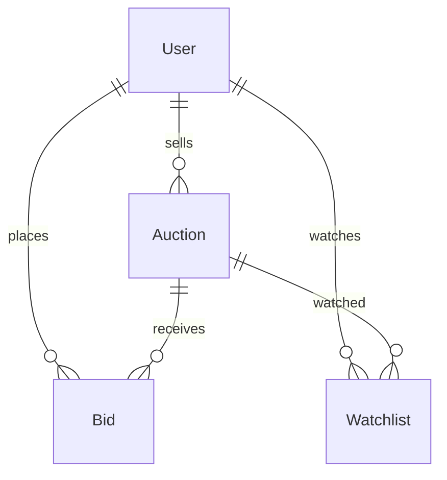

# Online Auction House

[← Back to Projects Index](README.md)

|                  |                                                                                             |
| ---------------- | ------------------------------------------------------------------------------------------- |
| **Slug**         | `auction-house`                                                                             |
| **Implement in** | `apps/api/` + `apps/web/` (auth on `apps/api-gateway`) on branch `<dev-name>/auction-house` |

## Problem

Selling an item to whoever pays the most only works if everyone follows the same rules: how much higher each bid must be, who is allowed to bid, and when bidding stops.

**Who uses this system**

| Actor      | Goal                                                       |
| ---------- | ---------------------------------------------------------- |
| **Seller** | List items for auction, watch bids come in, close auctions |
| **Bidder** | Browse open auctions, place bids, see what they won        |
| **Admin**  | Remove bad listings, see all auctions                      |

**Pain points you are solving**

- A bid lower than the current price gets accepted.
- Someone bids after the auction has ended.
- A seller bids on their own item to push the price up.
- Nobody can tell who won once the auction is over.

**What you are building**

An auction site where each auction sells one item. Bidders place bids, and every accepted bid raises the auction's current price. When the seller closes the auction, the highest bidder is saved as the winner.

## Application flow (end-to-end)

```text
1. Seller (staff) creates an Auction: title, description, category, starting price, minimum increment, end time
2. Bidder (user) browses open auctions → filters by category, price range, search text
3. Bidder opens an auction → sees current price and bid history → places a bid
4. Invariant: bid must beat current price by the minimum increment; auction open; not the seller
5. Place bid → transaction: create Bid + update Auction.currentPrice
6. Seller closes the auction → status closed, highest bidder saved as winner
7. Bidder sees won / lost auctions on "My bids"
8. Admin can cancel any auction; soft-deleted auctions are hidden from the list
```

## Roles in detail

| Domain role | Gateway role | Purpose                                  |
| ----------- | ------------ | ---------------------------------------- |
| **admin**   | `admin`      | Cancel or remove any auction             |
| **seller**  | `staff`      | Create, edit and close their own auction |
| **bidder**  | `user`       | Browse, bid, view own bids and wins      |

### admin

- **Can:** View every auction, cancel any open auction, soft-delete listings.
- **Typical screens:** `/admin/auctions` list with a cancel button.

### seller (maps to `staff`)

- **Can:** Create auctions; edit an auction until it gets its first bid; close their own auction; see all bids on it.
- **Cannot:** Bid on their own auction; edit or close someone else's auction; change the price after bids exist.
- **Typical screens:** `/seller` (my auctions), `/seller/auctions/new`, `/seller/auctions/[id]/edit`.

### bidder (maps to `user`)

- **Can:** Browse and search open auctions; place bids; see their own bid history and wins.
- **Cannot:** Bid on closed or cancelled auctions; bid less than the required amount.
- **Typical screens:** `/auctions`, `/auctions/[id]`, `/my/bids`.

## User journeys

These describe what should happen from the user's point of view. Walk through them while building and again before your demo.

### Everyone

#### Signing in to reach a private page _(Must)_

**Who:** Anyone who is not logged in

1. Someone opens `/my/bids` without logging in.
2. The app sends them to the login screen.
3. After they log in, they land on `/my/bids`.
4. Refreshing the page keeps them logged in.

#### Each role sees only their part of the app _(Must)_

**Who:** Bidder vs seller

1. A bidder logs in. Seller links such as "New auction" are hidden.
2. If they type `/seller` into the address bar, they see an access denied message.
3. When they log in as a seller instead, the seller pages work.

#### Empty and loading states on the auction list _(Must)_

**Who:** Anyone browsing

1. While auctions load, the user sees a skeleton or spinner.
2. If the filters match nothing, an empty state says so and offers a "Clear filters" button.

### Seller

#### Seller lists an item _(Must)_

**Who:** Seller (gateway role: `staff`)

1. The seller fills in the "New auction" form: title, description, category, starting price, minimum increment and end time.
2. The form shows errors for missing fields, a price of 0 or an end time in the past.
3. After saving, the auction appears in the public list with status "Open".

#### Seller closes an auction _(Must)_

**Who:** Seller

1. On their auction page, the seller sees every bid, highest first.
2. They click **Close auction** and confirm in a dialog.
3. The auction shows "Closed", the winner's bid is marked, and the bid button disappears for everyone.
4. If there were no bids, the auction closes with no winner.

### Bidder

#### Bidder places a bid _(Must)_

**Who:** Bidder (gateway role: `user`)

1. The bidder opens an open auction and sees the current price and the minimum next bid (for example "Current: ₹500 · Next bid at least ₹550").
2. They type an amount and click **Place bid**.
3. If the amount is high enough, the price updates right away and their bid appears at the top of the history.
4. If the amount is too low, they see a clear error and nothing changes.

#### Bidder checks their bids _(Should)_

**Who:** Bidder

1. `/my/bids` lists every auction they bid on.
2. Each row shows a badge: **Winning**, **Outbid**, **Won** or **Lost**.

## What is expected

### Must — required to pass

| Requirement            | What it means for you                                            |
| ---------------------- | ---------------------------------------------------------------- |
| Auth with 3 roles      | Seller, bidder and admin see different screens and actions       |
| Auction CRUD           | Seller creates and edits own auctions; soft-delete               |
| Place bid with checks  | The bid rules below are enforced in the service                  |
| Bid history            | Each auction shows its bids, highest first                       |
| Close auction + winner | Seller closes; highest bidder is saved as winner                 |
| Paginated list         | Filters: category, status, `q` (title search), min and max price |
| Shared Must bar        | [grading.md](../grading.md)                                      |

### Should — distinction

"My bids" page with Winning / Outbid / Won / Lost badges; seller dashboard with counts; watchlist; bids refused automatically once `endsAt` has passed, even if the seller hasn't closed the auction.

### Stretch — bonus

Auto-close auctions with a scheduled job; anti-sniping (a late bid adds 2 minutes); handling two bids that arrive at the same moment with a row lock.

## Frontend expectations

> Shared UI bar for all projects: [Frontend expectations](README.md#frontend-expectations-all-projects) · [frontend.md](../frontend.md)

### Domain screens

| Route                        | Role(s) | UI expectations                                               |
| ---------------------------- | ------- | ------------------------------------------------------------- |
| `/auctions`                  | All     | Card grid of open auctions; filter bar; pagination            |
| `/auctions/[id]`             | All     | Item details, current price, time left, bid history, bid form |
| `/my/bids` (Should)          | Bidder  | Table of auctions the user bid on with a status badge         |
| `/seller`                    | Seller  | Table of my auctions with status and bid count                |
| `/seller/auctions/new`       | Seller  | Create form with validation                                   |
| `/seller/auctions/[id]/edit` | Seller  | Edit form; disabled with a note once the auction has bids     |
| `/admin/auctions`            | Admin   | All auctions; cancel and delete buttons                       |

### UI behaviour

- **Bid form:** Show the minimum next bid above the input. Disable the button while the request is running.
- **After a bid:** Invalidate the auction query so the price and history refresh.
- **Closed auction:** Hide the bid form and show "Won by …" or "Closed with no bids".
- **Time left:** Plain text such as "Ends 12 Oct, 6:00 PM" is enough. A live countdown is optional.

## Backend expectations

> Shared API bar for all projects: [Backend expectations](README.md#backend-expectations-all-projects) · [architecture.md](../architecture.md)

### Modules

| Module               | Entity(ies) | Responsibility                              |
| -------------------- | ----------- | ------------------------------------------- |
| `auctions`           | `Auction`   | CRUD, list filters, close, cancel           |
| `bids`               | `Bid`       | Place bid (transaction), bid history        |
| `watchlist` (Should) | `Watchlist` | Save and remove auctions a user is watching |

### Key endpoints

| Method  | Path                   | Role         | Notes                                                                 |
| ------- | ---------------------- | ------------ | --------------------------------------------------------------------- |
| `GET`   | `/auctions`            | all          | Filters: `q`, `category`, `status`, `minPrice`, `maxPrice`; paginated |
| `POST`  | `/auctions`            | staff        | `sellerId` comes from the JWT, never the body                         |
| `PATCH` | `/auctions/:id`        | staff        | Owner only; 400 if the auction already has bids                       |
| `POST`  | `/auctions/:id/bids`   | user         | Transaction: create Bid + update `currentPrice`                       |
| `GET`   | `/auctions/:id/bids`   | all          | Highest first                                                         |
| `POST`  | `/auctions/:id/close`  | staff, admin | Owner or admin; sets `winnerId`                                       |
| `POST`  | `/auctions/:id/cancel` | admin        | Only open auctions                                                    |

### Service rules

- The first bid must be at least `startingPrice`. Every later bid must be at least `currentPrice + minIncrement`.
- Only `open` auctions accept bids, and only before `endsAt`.
- The seller can't bid on their own auction.
- Closing sets `status = closed` and `winnerId` to the bidder with the highest bid (or `null` if no bids).

### Enums and state machines

**Auction.status:** `open` → `closed`, or `open` → `cancelled`. A closed or cancelled auction never goes back to open.

### Database constraints

- `CHECK (bids.amount > 0)`
- `CHECK (auctions."startingPrice" > 0)` and `CHECK (auctions."minIncrement" > 0)`
- Foreign key `bids.auctionId → auctions.id`

### Domain seed (minimum)

5 auctions (3 open, 1 closed with a winner, 1 cancelled) and 8 bids spread across them.

### Web routes auth

| Route           | Auth required | Roles |
| --------------- | ------------- | ----- |
| /auctions       | No            | All   |
| /auctions/[id]  | No            | All   |
| /my/bids        | Yes           | user  |
| /seller/\*      | Yes           | staff |
| /admin/auctions | Yes           | admin |

## Suggested entities

- Auth `User` is on the gateway — use `userId` FKs; do **not** recreate users/auth in `apps/api`
- `Auction` (title, description, category, `startingPrice`, `minIncrement`, `currentPrice`, `endsAt`, status, `sellerId`, `winnerId`, `deletedAt`)
- `Bid` (`auctionId`, `bidderId`, amount, `createdAt`)
- `Watchlist` (Should)

## ERD (starter)



## Hard invariant

A bid is accepted only when the auction is `open`, the time is before `endsAt`, the bidder isn't the seller, and the amount is at least `currentPrice + minIncrement` (or at least `startingPrice` for the first bid).

## Required transaction

Placing a bid: create the `Bid` row and update `Auction.currentPrice` in one transaction. If either write fails, neither is saved.

## Must (pass)

- [ ] Auth with admin / seller / bidder roles
- [ ] Seller creates, edits and soft-deletes their own auctions
- [ ] Place a bid with the invariant above enforced
- [ ] Bid history on the auction page
- [ ] Seller closes an auction and the winner is saved
- [ ] Paginated auction list with category, status, `q` and price filters

Plus the shared Must bar in [grading.md](../grading.md).

## Should (distinction)

- [ ] "My bids" page with Winning / Outbid / Won / Lost badges
- [ ] Bids refused automatically once `endsAt` has passed
- [ ] Seller dashboard: open auctions, total bids, items sold
- [ ] Watchlist

## Stretch (bonus)

- [ ] Auto-close auctions with a scheduled job
- [ ] Anti-sniping: a bid in the last 2 minutes pushes `endsAt` back by 2 minutes
- [ ] Two bids sent at the same moment can't both win (row lock or version column)

## API outline (indicative)

- `CRUD /auctions`
- `POST /auctions/:id/close` · `POST /auctions/:id/cancel`
- `GET /auctions/:id/bids` · `POST /auctions/:id/bids`
- `GET /my/bids`
- `GET|POST|DELETE /watchlist` (Should)

## FE routes (indicative)

- `/`
- `/auctions`
- `/auctions/[id]`
- `/my/bids`
- `/seller`
- `/seller/auctions/new`
- `/admin/auctions`
- `/login`

> Shared: [FAQ & edge cases](README.md#faq--read-before-you-ask) · [grading](../grading.md)

## Edge cases and negative scenarios

| Scenario                                | Expected API | UI hint                               |
| --------------------------------------- | ------------ | ------------------------------------- |
| Bid below the minimum next bid          | **400**      | Show the minimum amount in the error  |
| Bid on a closed or cancelled auction    | **400**      | Bid form hidden                       |
| Seller bids on own auction              | **403**      | Bid form hidden for the seller        |
| Bid after `endsAt` (Should)             | **400**      | "This auction has ended"              |
| Edit an auction that already has bids   | **400**      | Edit button disabled with a note      |
| Close someone else's auction            | **403**      | Close button only shown to the owner  |
| Close an auction that is already closed | **400**      | —                                     |
| Open a soft-deleted auction             | **404**      | "This auction is no longer available" |

### Demo 4xx cases

1. Bid too low → **400**
2. Seller bids on own auction → **403**
3. Bid on a closed auction → **400**

## FAQ — decisions already made

| Question                                   | Answer                                                                                     |
| ------------------------------------------ | ------------------------------------------------------------------------------------------ |
| One item per auction or many?              | **One item.** The auction row holds the item details.                                      |
| Does the auction close on its own?         | **No (Must).** The seller clicks Close. Auto-close is Stretch.                             |
| Real payments?                             | **No.** Saving the winner is enough.                                                       |
| What if two people bid at the same moment? | Ignore it for Must. Handling it is a Stretch goal.                                         |
| Store money as float?                      | **No.** Use `numeric(10,2)` in Postgres, or store whole rupees/paise as an integer.        |
| How do I find the highest bid?             | Order the auction's bids by `amount DESC` and take the first, or just read `currentPrice`. |

## Definition of done

- Domain migrations (`pnpm migration:run:api`) + domain seed (≥8 realistic rows); gateway users via `pnpm seed`
- Compose Postgres + root `.env` + `apps/api-gateway/.env` + `apps/api/.env` + `apps/web/.env.local`
- Next + Query + RTK ownership respected; UI uses `@shared/ui/components` + theme ([frontend.md](../frontend.md))
- `docs/architecture.md` completed
- 5-minute demo script in the PR body (and notes in `docs/architecture.md`)

## Demo script (suggested — adapt for your PR)

1. **Roles (30s):** Seller pages → bidder pages → admin page.
2. **Happy path (2m):** Seller creates an auction → bidder places two bids → seller closes it → winner shown.
3. **Invariant (30s):** Bid too low, or seller bids on own auction → 4xx.
4. **Lists (1m):** Filter by category and price; soft-delete an auction and show it's gone from the list.
