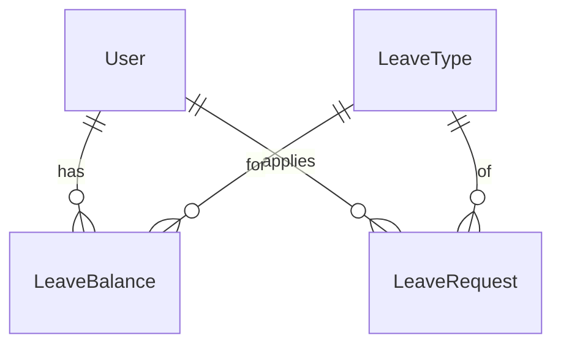

# Leave Management

[← Back to Projects Index](README.md)

|                  |                                                                                                |
| ---------------- | ---------------------------------------------------------------------------------------------- |
| **Slug**         | `leave-management`                                                                             |
| **Implement in** | `apps/api/` + `apps/web/` (auth on `apps/api-gateway`) on branch `<dev-name>/leave-management` |

## Problem

In many small companies, people ask for leave over chat and someone keeps the balances in a spreadsheet.

**Who uses this system**

| Actor        | Goal                                                    |
| ------------ | ------------------------------------------------------- |
| **Employee** | Apply for leave, see their balance and request status   |
| **Manager**  | Approve or reject leave requests                        |
| **Admin**    | Set up leave types and give each employee their balance |

**Pain points you are solving**

- An employee takes more days than they have left.
- Two leave requests from the same person cover the same dates.
- A request is approved but the balance is never updated.
- Nobody can see who is on leave on a given day.

**What you are building**

A leave app. Admin creates leave types (Casual, Sick, Earned) and gives each employee a yearly balance. Employees apply for dates, the app counts the working days, and a manager approves or rejects. Approving a request takes the days off the employee's balance.

## Application flow (end-to-end)

```text
1. Admin creates LeaveTypes (Casual 12 days, Sick 8 days, …)
2. Admin gives each employee a LeaveBalance per type for the year
3. Employee (user) applies: leave type, start date, end date, reason
4. API counts working days (Mon to Fri) between the two dates
5. Invariant: no overlapping requests; enough balance left
6. Manager (staff) sees pending requests → approves or rejects with a comment
7. Approve → transaction: request status approved + balance usedDays increased
8. Employee can cancel a request while it is still pending
```

## Roles in detail

| Domain role  | Gateway role | Purpose                                     |
| ------------ | ------------ | ------------------------------------------- |
| **admin**    | `admin`      | Leave types and employee balances           |
| **manager**  | `staff`      | Approve or reject requests                  |
| **employee** | `user`       | Apply, cancel, view own balance and history |

### admin

- **Can:** Create, edit and delete leave types; set each employee's balance for a year; view all requests.
- **Typical screens:** `/admin/leave-types`, `/admin/balances`.

### manager (maps to `staff`)

- **Can:** See every pending request; approve or reject with a comment; see all requests with filters.
- **Cannot:** Approve their own request; approve a request that is already approved, rejected or cancelled.
- **Typical screens:** `/manager/requests`.

### employee (maps to `user`)

- **Can:** Apply for leave; see their balance per leave type; see their own requests; cancel a pending request.
- **Cannot:** See other employees' requests; approve anything; apply for more days than they have left.
- **Typical screens:** `/leave`, `/leave/new`, `/leave/[id]`.

## User journeys

These describe what should happen from the user's point of view. Walk through them while building and again before your demo.

### Everyone

#### Signing in to reach a private page _(Must)_

**Who:** Anyone who is not logged in

1. Someone opens `/leave` without logging in.
2. The app sends them to the login screen.
3. After they log in, they land on `/leave`.
4. Refreshing the page keeps them logged in.

#### Each role sees only their part of the app _(Must)_

**Who:** Employee vs manager

1. An employee logs in. The "Approvals" link is hidden.
2. If they type `/manager/requests` into the address bar, they see an access denied message.
3. Logging in as a manager shows the approvals page.

#### Empty and loading states _(Must)_

**Who:** Anyone viewing a list

1. While requests load, the user sees a skeleton or spinner.
2. A new employee with no requests sees "You haven't applied for leave yet" and an **Apply** button.

### Admin

#### Admin sets up leave types and balances _(Must)_

**Who:** Admin (gateway role: `admin`)

1. The admin creates leave types such as Casual (12 days) and Sick (8 days).
2. On the balances page they pick an employee and a year, and set the total days for each type.
3. The employee now sees those balances on their dashboard.

### Employee

#### Employee applies for leave _(Must)_

**Who:** Employee (gateway role: `user`)

1. On `/leave` the employee sees cards like "Casual: 9 of 12 days left".
2. They click **Apply**, pick a leave type, a start date and an end date, and type a reason.
3. The form shows how many working days this is (for example "3 working days, Fri to Tue").
4. After submitting, the request appears in their list as **Pending**.
5. If the dates overlap another request, or they don't have enough days, they see a clear error and nothing is saved.

#### Employee cancels a request _(Must)_

**Who:** Employee

1. On a pending request, the employee clicks **Cancel** and confirms.
2. The status changes to **Cancelled**. Approved requests don't show the Cancel button.

### Manager

#### Manager approves or rejects _(Must)_

**Who:** Manager (gateway role: `staff`)

1. `/manager/requests` shows pending requests: employee, leave type, dates, working days and reason.
2. The manager clicks **Approve**. The status changes and the employee's balance goes down by that many days.
3. Or the manager clicks **Reject**, types a comment, and confirms. The balance doesn't change.
4. The employee sees the new status and the manager's comment on their request.

#### Manager sees who is away _(Should)_

**Who:** Manager

1. A "Who's away" page lists approved leave for the next 14 days, grouped by date.

## What is expected

### Must — required to pass

| Requirement            | What it means for you                                                |
| ---------------------- | -------------------------------------------------------------------- |
| Auth with 3 roles      | Admin, manager and employee see different screens and actions        |
| Leave types + balances | Admin CRUD for types; admin sets balances                            |
| Apply for leave        | Working days counted (Mon to Fri); overlap and balance checks        |
| Approve / reject       | Manager decides; approve updates the balance in a transaction        |
| Cancel pending         | Employee can cancel own pending request                              |
| Paginated list         | Filters: status, leave type, date range; soft-delete on LeaveRequest |
| Shared Must bar        | [grading.md](../grading.md)                                          |

### Should — distinction

Public holidays that don't count as working days; "Who's away" page; employee dashboard with balance cards and a recent-requests table; reject requires a comment.

### Stretch — bonus

Half-day leave; second approval by admin for requests longer than 5 days; carrying unused days into next year.

## Frontend expectations

> Shared UI bar for all projects: [Frontend expectations](README.md#frontend-expectations-all-projects) · [frontend.md](../frontend.md)

### Domain screens

| Route                    | Role(s)  | UI expectations                                                    |
| ------------------------ | -------- | ------------------------------------------------------------------ |
| `/leave`                 | Employee | Balance cards per type; my requests table with status badges       |
| `/leave/new`             | Employee | Apply form; shows working-day count before submit                  |
| `/leave/[id]`            | Employee | Request details, status, manager comment, Cancel button if pending |
| `/manager/requests`      | Manager  | Filter bar (status, type, dates); Approve / Reject buttons per row |
| `/manager/away` (Should) | Manager  | Approved leave for the next 14 days, grouped by date               |
| `/admin/leave-types`     | Admin    | Table + create/edit dialog                                         |
| `/admin/balances`        | Admin    | Pick employee + year; edit total days per leave type               |

### UI behaviour

- **Status badges:** Pending (yellow), Approved (green), Rejected (red), Cancelled (grey). Use `Badge` from `@shared/ui/components`.
- **Reject dialog:** Use `Dialog` with a comment field.
- **Apply form:** Keep the draft in Redux so it survives a page change. Clear it after a successful submit.
- **Filters:** Keep manager filters in Redux; fetch with TanStack Query.

## Backend expectations

> Shared API bar for all projects: [Backend expectations](README.md#backend-expectations-all-projects) · [architecture.md](../architecture.md)

### Modules

| Module              | Entity(ies)    | Responsibility                               |
| ------------------- | -------------- | -------------------------------------------- |
| `leave-types`       | `LeaveType`    | Admin CRUD                                   |
| `balances`          | `LeaveBalance` | Admin sets totals; employee reads own        |
| `leave-requests`    | `LeaveRequest` | Apply, cancel, approve (transaction), reject |
| `holidays` (Should) | `Holiday`      | Dates that don't count as working days       |

### Key endpoints

| Method | Path                          | Role         | Notes                                                     |
| ------ | ----------------------------- | ------------ | --------------------------------------------------------- |
| `GET`  | `/balances/me`                | user         | Current year, one row per leave type                      |
| `PUT`  | `/balances`                   | admin        | Body: `userId`, `leaveTypeId`, `year`, `totalDays`        |
| `POST` | `/leave-requests`             | user         | Counts working days; checks overlap and balance           |
| `GET`  | `/leave-requests/me`          | user         | Own requests, paginated                                   |
| `GET`  | `/leave-requests`             | staff, admin | Filters: `status`, `leaveTypeId`, `from`, `to`; paginated |
| `POST` | `/leave-requests/:id/approve` | staff        | Transaction: status + balance                             |
| `POST` | `/leave-requests/:id/reject`  | staff        | Body: `comment`                                           |
| `POST` | `/leave-requests/:id/cancel`  | user         | Owner only; pending only                                  |

### Service rules

- `days` = number of Monday to Friday dates from `startDate` to `endDate`, both included. A simple loop over each date is fine.
- `days` must be at least 1 (a request for only Saturday and Sunday is rejected).
- No overlap with the same employee's `pending` or `approved` requests.
- Days left = `totalDays - usedDays - (sum of days in pending requests)`. The new request's `days` must not be more than that.
- Only `pending` requests can be approved, rejected or cancelled.
- A manager can't approve their own request.

### Enums and state machines

**LeaveRequest.status:** `pending` → `approved`, `pending` → `rejected`, `pending` → `cancelled`. Nothing moves out of approved, rejected or cancelled.

### Database constraints

- `CHECK ("endDate" >= "startDate")`
- `CHECK (days > 0)`
- `UNIQUE (userId, leaveTypeId, year)` on `leave_balances`
- `CHECK ("usedDays" <= "totalDays")` on `leave_balances`

### Domain seed (minimum)

3 leave types, balances for 3 employees, and 8 requests covering every status.

### Web routes auth

| Route       | Auth required | Roles |
| ----------- | ------------- | ----- |
| /leave/\*   | Yes           | user  |
| /manager/\* | Yes           | staff |
| /admin/\*   | Yes           | admin |

## Suggested entities

- Auth `User` is on the gateway — use `userId` FKs; do **not** recreate users/auth in `apps/api`
- `LeaveType` (name, `defaultDays`)
- `LeaveBalance` (`userId`, `leaveTypeId`, year, `totalDays`, `usedDays`)
- `LeaveRequest` (`userId`, `leaveTypeId`, `startDate`, `endDate`, days, reason, status, `managerId`, `managerComment`, `deletedAt`)
- `Holiday` (Should)

## ERD (starter)



## Hard invariant

An employee can't have two `pending` or `approved` requests with overlapping dates, and can't request more days than they have left for that leave type.

Two date ranges overlap when `existing.startDate <= new.endDate AND existing.endDate >= new.startDate`.

## Required transaction

Approving a request: set the request's status to `approved` and add its `days` to `LeaveBalance.usedDays`, in one transaction. If either write fails, neither is saved.

## Must (pass)

- [ ] Auth with admin / manager / employee roles
- [ ] Admin CRUD for leave types; admin sets balances
- [ ] Employee applies for leave with working days counted and the invariant enforced
- [ ] Manager approves (transaction) or rejects with a comment
- [ ] Employee cancels a pending request
- [ ] Paginated request list with status, leave type and date filters; soft-delete on `LeaveRequest`

Plus the shared Must bar in [grading.md](../grading.md).

## Should (distinction)

- [ ] Public holidays skipped when counting working days
- [ ] "Who's away" page for the next 14 days
- [ ] Employee dashboard with balance cards and recent requests
- [ ] Reject requires a comment

## Stretch (bonus)

- [ ] Half-day leave (0.5 days)
- [ ] Second approval by admin for requests longer than 5 days
- [ ] Carry up to 5 unused days into next year

## API outline (indicative)

- `CRUD /leave-types`
- `GET /balances/me` · `GET /balances?userId=` · `PUT /balances`
- `POST /leave-requests` · `GET /leave-requests/me` · `GET /leave-requests`
- `POST /leave-requests/:id/approve` · `/reject` · `/cancel`
- `CRUD /holidays` (Should)

## FE routes (indicative)

- `/`
- `/leave`
- `/leave/new`
- `/leave/[id]`
- `/manager/requests`
- `/admin/leave-types`
- `/admin/balances`
- `/login`

> Shared: [FAQ & edge cases](README.md#faq--read-before-you-ask) · [grading](../grading.md)

## Edge cases and negative scenarios

| Scenario                                | Expected API | UI hint                             |
| --------------------------------------- | ------------ | ----------------------------------- |
| End date before start date              | **400**      | Date picker blocks it               |
| Only weekend days selected              | **400**      | "No working days in this range"     |
| Dates overlap an existing request       | **409**      | Name the clashing request's dates   |
| Not enough days left                    | **400**      | Show days left next to the form     |
| No balance set for this leave type      | **400**      | "Ask HR to set your balance"        |
| Approve a request that isn't pending    | **400**      | Buttons hidden for non-pending rows |
| Manager approves own request            | **403**      | Buttons hidden on own rows          |
| Employee cancels someone else's request | **403**      | —                                   |

### Demo 4xx cases

1. Overlapping dates → **409**
2. More days than the balance → **400**
3. Approve an already approved request → **400**

## FAQ — decisions already made

| Question                            | Answer                                                                          |
| ----------------------------------- | ------------------------------------------------------------------------------- |
| Teams and per-team managers?        | **No.** Any manager can approve any employee's request.                         |
| Do weekends count?                  | **No.** Count Monday to Friday only.                                            |
| Holidays?                           | **Should.** For Must, only weekends are skipped.                                |
| Half days?                          | **Stretch.** Must uses whole days.                                              |
| Can an approved leave be cancelled? | **No** for Must.                                                                |
| Where does the year come from?      | The year of `startDate`. A request can't cross into the next year (return 400). |
| How do I store dates?               | Postgres `date` columns (no time). Send `YYYY-MM-DD` strings from the UI.       |

## Definition of done

- Domain migrations (`pnpm migration:run:api`) + domain seed (≥8 realistic rows); gateway users via `pnpm seed`
- Compose Postgres + root `.env` + `apps/api-gateway/.env` + `apps/api/.env` + `apps/web/.env.local`
- Next + Query + RTK ownership respected; UI uses `@shared/ui/components` + theme ([frontend.md](../frontend.md))
- `docs/architecture.md` completed
- 5-minute demo script in the PR body (and notes in `docs/architecture.md`)

## Demo script (suggested — adapt for your PR)

1. **Roles (30s):** Admin pages → manager approvals → employee dashboard.
2. **Happy path (2m):** Employee applies over a weekend (shows working days) → manager approves → balance goes down.
3. **Invariant (30s):** Overlapping dates or too many days → 4xx.
4. **Lists (1m):** Filter requests by status and date; soft-delete a request.
