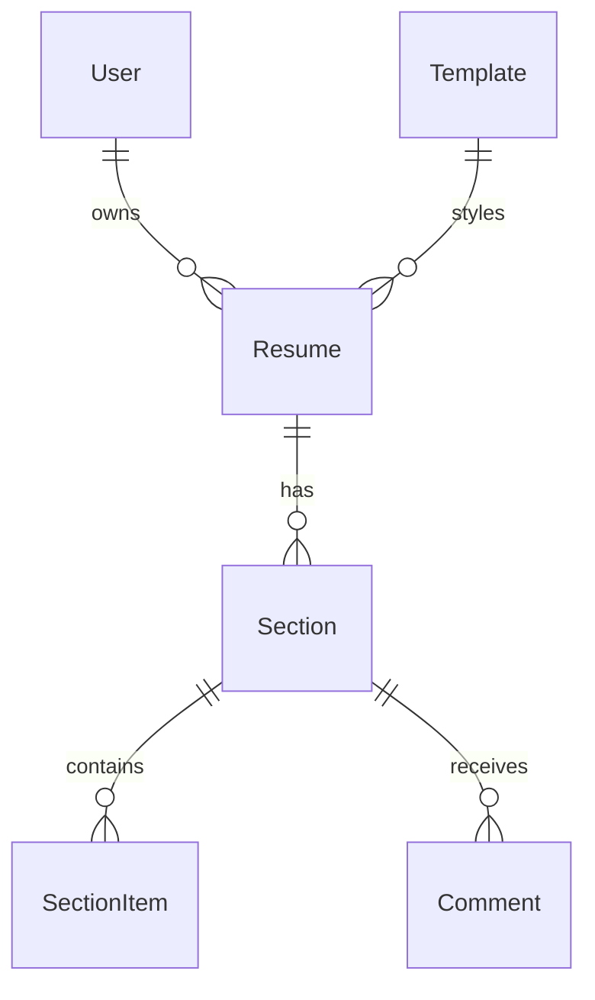

# Resume Builder

[← Back to Projects Index](README.md)

|                  |                                                                                              |
| ---------------- | -------------------------------------------------------------------------------------------- |
| **Slug**         | `resume-builder`                                                                             |
| **Implement in** | `apps/api/` + `apps/web/` (auth on `apps/api-gateway`) on branch `<dev-name>/resume-builder` |

## Problem

Most people write resumes in a word processor. This app lets them type their details into forms, watch the resume update next to the form, switch designs, and share a public link.

This project is **frontend-heavy**. The backend is plain CRUD; most of the work and most of the marks are in the editor and preview.

**Who uses this system**

| Actor         | Goal                                                  |
| ------------- | ----------------------------------------------------- |
| **Candidate** | Build resumes, preview them, publish a shareable link |
| **Coach**     | Read published resumes and leave feedback (Should)    |
| **Admin**     | Turn templates on or off, see all resumes             |

**Pain points you are solving**

- Layout breaks every time a line is added.
- Changing the design means retyping everything.
- Sending the latest version means exporting and emailing a file again.

**What you are building**

A resume editor with a form on the left and a live preview on the right. A resume has contact details, a summary, and sections (Experience, Education, Skills, Projects), and each section has items. The candidate picks one of three templates and can publish the resume at a public link such as `/r/asha-sharma`.

## Application flow (end-to-end)

```text
1. Candidate (user) creates a Resume: title + template
2. Fills in contact details and summary
3. Adds Sections (Experience, Education, …) and Items inside each section
4. Moves sections and items up or down; the preview updates as they type
5. Switches template; the same content shows in a different design
6. Publishes → invariant: contact details + at least one experience or education item
7. Public page /r/[slug] works without logging in
8. Duplicate → transaction: copy resume + all sections + all items
```

## Roles in detail

| Domain role   | Gateway role | Purpose                                     |
| ------------- | ------------ | ------------------------------------------- |
| **admin**     | `admin`      | Manage templates; see all resumes           |
| **coach**     | `staff`      | Comment on published resumes (Should)       |
| **candidate** | `user`       | Create, edit, publish and duplicate resumes |

### admin

- **Can:** Turn templates on or off; see a list of all resumes with filters.
- **Typical screens:** `/admin/templates`, `/admin/resumes`.

### coach (maps to `staff`)

- **Can (Should):** See published resumes; leave a comment on a section.
- **Cannot:** Edit a candidate's resume.
- **Typical screens:** `/coach`.

### candidate (maps to `user`)

- **Can:** Create, edit, duplicate, publish, unpublish and delete their own resumes.
- **Cannot:** See or edit other candidates' drafts; publish an incomplete resume; pick a template the admin turned off.
- **Typical screens:** `/resumes`, `/resumes/[id]/edit`.

## User journeys

These describe what should happen from the user's point of view. Walk through them while building and again before your demo.

### Everyone

#### Signing in to reach a private page _(Must)_

**Who:** Anyone who is not logged in

1. Someone opens `/resumes` without logging in.
2. The app sends them to the login screen.
3. After they log in, they land on `/resumes`.
4. Refreshing the page keeps them logged in.

#### Each role sees only their part of the app _(Must)_

**Who:** Candidate vs admin

1. A candidate logs in. Admin links are hidden.
2. If they type `/admin/templates` into the address bar, they see an access denied message.
3. Logging in as admin shows the template page.

#### Viewing a public resume _(Must)_

**Who:** Anyone, logged in or not

1. Someone opens a link like `/r/asha-sharma`.
2. They see the resume in its chosen template, without the editor.
3. If the resume was unpublished or deleted, they see "This resume is not available".

### Candidate

#### Candidate builds a resume _(Must)_

**Who:** Candidate (gateway role: `user`)

1. On `/resumes`, the candidate clicks **New resume**, enters a title and picks a template.
2. The editor opens: form on the left, preview on the right.
3. As they type their name, the preview shows it straight away.
4. They add an Experience section, then add two jobs to it.
5. They click **Save**. A "Saved" message appears. Leaving the page and coming back shows the same content.

#### Candidate reorders and restyles _(Must)_

**Who:** Candidate

1. Each section and item has **Move up** and **Move down** buttons.
2. Clicking one changes the order in the form and the preview at the same time.
3. The candidate opens the template picker and chooses another design. All content stays; only the look changes.

#### Candidate publishes and shares _(Must)_

**Who:** Candidate

1. The candidate clicks **Publish**.
2. If the email or name is missing, or there's no experience or education item, they see a list of what to fill in.
3. Once published, they see the public link and a **Copy link** button.
4. **Unpublish** takes the public page down.

#### Candidate duplicates a resume _(Must)_

**Who:** Candidate

1. On the resume list, the candidate clicks **Duplicate** on a resume.
2. A copy called "<title> (copy)" appears as a draft with all the same sections and items.

### Coach

#### Coach leaves feedback _(Should)_

**Who:** Coach (gateway role: `staff`)

1. `/coach` lists published resumes.
2. The coach opens one and adds a comment to a section ("Add numbers to these bullets").
3. The candidate sees the comment next to that section in the editor.

## What is expected

### Must — required to pass

| Requirement           | What it means for you                                          |
| --------------------- | -------------------------------------------------------------- |
| Auth with 2+ roles    | Candidate and admin see different screens                      |
| Resume CRUD           | Create, edit, delete (soft-delete), list own resumes           |
| Sections + items      | Add, edit, remove, move up/down                                |
| Live preview          | Preview updates while typing, before saving                    |
| 3 templates           | Switching keeps content; each template looks clearly different |
| Publish + public page | Invariant enforced; `/r/[slug]` works logged out               |
| Duplicate             | Copies resume, sections and items in one transaction           |
| Paginated list        | Filters: status, template, `q` (title search)                  |
| Shared Must bar       | [grading.md](../grading.md)                                    |

### Should — distinction

Drag-and-drop reordering; "Unsaved changes" warning when leaving the editor; print stylesheet so "Save as PDF" in the browser looks clean; coach comments; mobile layout where preview sits under the form.

### Stretch — bonus

Custom accent colour per resume; view counter on the public page; dark version of each template; keyboard shortcuts in the editor.

## Frontend expectations

> Shared UI bar for all projects: [Frontend expectations](README.md#frontend-expectations-all-projects) · [frontend.md](../frontend.md)

### Domain screens

| Route                | Role(s)   | UI expectations                                                                    |
| -------------------- | --------- | ---------------------------------------------------------------------------------- |
| `/resumes`           | Candidate | Card grid or table; filters; New, Duplicate, Delete actions                        |
| `/resumes/new`       | Candidate | Title + template picker (show a small preview image for each template)             |
| `/resumes/[id]/edit` | Candidate | Two columns: form on the left, live preview on the right; Save and Publish buttons |
| `/r/[slug]`          | Public    | Resume only, no app header or editor                                               |
| `/coach` (Should)    | Coach     | List of published resumes; open one to comment                                     |
| `/admin/templates`   | Admin     | Table of templates with an active toggle                                           |
| `/admin/resumes`     | Admin     | All resumes with filters                                                           |

### UI behaviour

- **Draft in Redux:** Load the resume with TanStack Query, copy it into a Redux draft, and let the form edit the draft. The preview reads from the same draft, so it updates while typing. **Save** sends the draft to the API.
- **Templates are components:** Write one React component per template (`ClassicTemplate`, `ModernTemplate`, `CompactTemplate`). Each takes the same `resume` prop and lays it out differently.
- **Reordering:** For Must, Move up / Move down buttons that swap `position` values are enough.
- **Saving state:** Show "Saving…", "Saved" or an error message near the Save button.
- **Publish errors:** Show the API's list of missing fields with an `Alert`.

## Backend expectations

> Shared API bar for all projects: [Backend expectations](README.md#backend-expectations-all-projects) · [architecture.md](../architecture.md)

### Modules

| Module              | Entity(ies)                        | Responsibility                               |
| ------------------- | ---------------------------------- | -------------------------------------------- |
| `templates`         | `Template`                         | Seeded list; admin toggles `isActive`        |
| `resumes`           | `Resume`, `Section`, `SectionItem` | CRUD, save, publish, duplicate (transaction) |
| `public`            | —                                  | `GET /public/resumes/:slug` with `@Public()` |
| `comments` (Should) | `Comment`                          | Coach comments on a section                  |

### Key endpoints

| Method   | Path                     | Role   | Notes                                                         |
| -------- | ------------------------ | ------ | ------------------------------------------------------------- |
| `GET`    | `/resumes`               | user   | Own resumes; filters `status`, `templateId`, `q`; paginated   |
| `POST`   | `/resumes`               | user   | `ownerId` from JWT                                            |
| `GET`    | `/resumes/:id`           | user   | Owner only; returns sections and items, ordered by `position` |
| `PUT`    | `/resumes/:id`           | user   | Saves the whole draft: resume fields + sections + items       |
| `POST`   | `/resumes/:id/publish`   | user   | Checks the invariant; sets `slug` and `status`                |
| `POST`   | `/resumes/:id/unpublish` | user   | Back to `draft`                                               |
| `POST`   | `/resumes/:id/duplicate` | user   | Transaction: copy resume + sections + items                   |
| `DELETE` | `/resumes/:id`           | user   | Soft-delete                                                   |
| `GET`    | `/public/resumes/:slug`  | public | 404 unless published and not deleted                          |
| `PATCH`  | `/templates/:id`         | admin  | Toggle `isActive`                                             |

### Service rules

- Only the owner can read or change a draft.
- Publishing needs `fullName`, `email`, and at least one item in an Experience or Education section.
- The slug comes from the full name (`Asha Sharma` → `asha-sharma`). If it's taken, add a number (`asha-sharma-2`).
- New resumes can only use active templates.
- Saving the whole draft with one `PUT` is fine. Delete the old sections and items and insert the new ones inside a transaction, or update them one by one.

### Enums and state machines

**Resume.status:** `draft` ↔ `published`.

**Section.type:** `experience`, `education`, `skills`, `projects`, `custom`.

### Database constraints

- `UNIQUE (resumes.slug)` (nullable; only published resumes have a slug)
- Foreign keys with `ON DELETE CASCADE` from items to sections and sections to resumes
- `CHECK (position >= 0)` on sections and items

### Domain seed (minimum)

3 templates and 3 resumes (2 drafts, 1 published) with sections and items, giving 8+ rows in total.

### Web routes auth

| Route       | Auth required | Roles |
| ----------- | ------------- | ----- |
| /r/[slug]   | No            | All   |
| /resumes/\* | Yes           | user  |
| /coach      | Yes           | staff |
| /admin/\*   | Yes           | admin |

## Suggested entities

- Auth `User` is on the gateway — use `userId` FKs; do **not** recreate users/auth in `apps/api`
- `Template` (name, key, `isActive`)
- `Resume` (`ownerId`, title, `templateId`, `fullName`, email, phone, location, summary, status, slug, `deletedAt`)
- `Section` (`resumeId`, type, title, position)
- `SectionItem` (`sectionId`, heading, subheading, `startDate`, `endDate`, description, position)
- `Comment` (Should)

## ERD (starter)



## Hard invariant

A resume can be published only when it has a full name, an email, and at least one item in an Experience or Education section. Every published resume has a unique slug.

## Required transaction

Duplicating a resume: insert the new `Resume`, then copy every `Section` and every `SectionItem` under it, in one transaction. If any insert fails, no partial copy is left behind.

## Must (pass)

- [ ] Auth with candidate and admin roles
- [ ] Resume CRUD with soft-delete
- [ ] Sections and items: add, edit, remove, move up/down
- [ ] Live preview that updates while typing
- [ ] Three templates; switching keeps all content
- [ ] Publish with the invariant; public page at `/r/[slug]`
- [ ] Duplicate in a transaction
- [ ] Paginated resume list with status, template and `q` filters

Plus the shared Must bar in [grading.md](../grading.md).

## Should (distinction)

- [ ] Drag-and-drop reordering
- [ ] "Unsaved changes" warning before leaving the editor
- [ ] Print stylesheet for a clean "Save as PDF"
- [ ] Coach comments on sections
- [ ] Mobile layout with the preview below the form

## Stretch (bonus)

- [ ] Accent colour picker per resume
- [ ] View counter on the public page
- [ ] Dark version of each template
- [ ] Keyboard shortcuts (Ctrl+S to save)

## API outline (indicative)

- `CRUD /resumes`
- `POST /resumes/:id/publish` · `/unpublish` · `/duplicate`
- `GET /public/resumes/:slug`
- `GET /templates` · `PATCH /templates/:id`
- `CRUD /sections/:id/comments` (Should)

## FE routes (indicative)

- `/`
- `/resumes`
- `/resumes/new`
- `/resumes/[id]/edit`
- `/r/[slug]`
- `/coach`
- `/admin/templates`
- `/login`

> Shared: [FAQ & edge cases](README.md#faq--read-before-you-ask) · [grading](../grading.md)

## Edge cases and negative scenarios

| Scenario                                  | Expected API | UI hint                                     |
| ----------------------------------------- | ------------ | ------------------------------------------- |
| Publish without name or email             | **400**      | List the missing fields                     |
| Publish with no experience/education item | **400**      | Same list                                   |
| Open someone else's draft                 | **404**      | "Resume not found"                          |
| Public link to a draft or deleted resume  | **404**      | "This resume is not available"              |
| Create with an inactive template          | **400**      | Inactive templates hidden in the picker     |
| Two people named "Asha Sharma" publish    | **200**      | Second gets `asha-sharma-2`                 |
| Move the first section up                 | No change    | Disable the Move up button on the first row |

### Demo 4xx cases

1. Publish an empty resume → **400**
2. Open another user's resume by ID → **404**
3. Open a public link after unpublishing → **404**

## FAQ — decisions already made

| Question                       | Answer                                                                                        |
| ------------------------------ | --------------------------------------------------------------------------------------------- |
| PDF download?                  | **No server PDFs.** A print stylesheet plus the browser's "Save as PDF" is the Should goal.   |
| Drag and drop?                 | **Should.** Up/down buttons are enough for Must.                                              |
| Where do templates live?       | As React components in `apps/web`. The `Template` table only stores name, key and `isActive`. |
| Does the preview call the API? | **No.** It reads the Redux draft. Only Save and Publish call the API.                         |
| Photo upload?                  | **No.** Text only.                                                                            |
| Version history?               | **No.** The public page shows the current saved content.                                      |

## Definition of done

- Domain migrations (`pnpm migration:run:api`) + domain seed (≥8 realistic rows); gateway users via `pnpm seed`
- Compose Postgres + root `.env` + `apps/api-gateway/.env` + `apps/api/.env` + `apps/web/.env.local`
- Next + Query + RTK ownership respected; UI uses `@shared/ui/components` + theme ([frontend.md](../frontend.md))
- `docs/architecture.md` completed
- 5-minute demo script in the PR body (and notes in `docs/architecture.md`)

## Demo script (suggested — adapt for your PR)

1. **Roles (30s):** Candidate editor → admin templates page.
2. **Happy path (2m):** Build a resume while the preview updates → reorder sections → switch template → publish → open the public link in a private window.
3. **Invariant (30s):** Publish an empty resume → 4xx with the missing fields.
4. **Lists (1m):** Filter resumes by status and template; duplicate one; soft-delete one.
